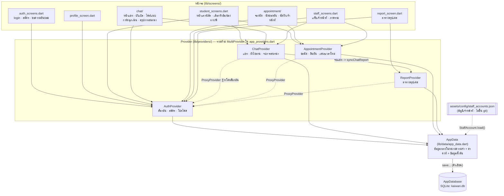
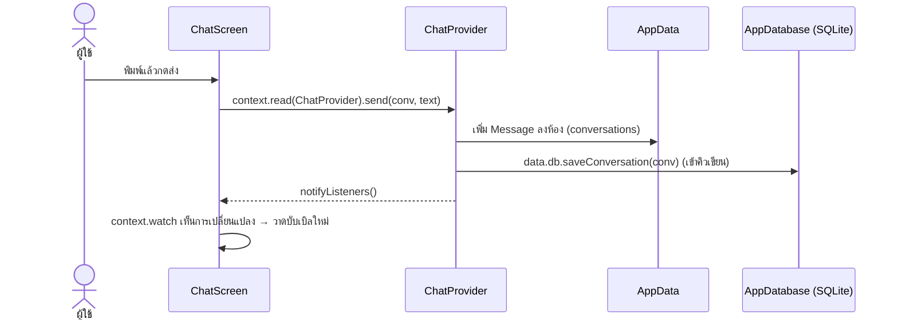

# 1. โครงสร้างระบบ (Architecture)

หน้าจอไม่คุยกับฐานข้อมูลโดยตรง แต่ผ่าน **Provider** (บทที่ 10–11) ซึ่งแยกตามฟีเจอร์ 4 ตัว
ทุกตัวใช้ข้อมูลกลาง `AppData` ร่วมกัน และ `AppData` บันทึกลง SQLite ผ่าน `AppDatabase`

## วิธีที่หน้าจอใช้ Provider

| ที่ไหน | ใช้อะไร | ผล |
|---|---|---|
| ใน `build()` | `context.watch<ChatProvider>()` | ข้อมูลเปลี่ยน (`notifyListeners`) → หน้าจอวาดใหม่เอง |
| ในปุ่ม / คำสั่ง | `context.read<ChatProvider>().send(...)` | เรียกใช้อย่างเดียว ไม่ฟังการเปลี่ยนแปลง |
| Provider พึ่ง Provider | `ChangeNotifierProxyProvider` | ล็อกอินคนใหม่ → `update(auth)` → Provider นั้นแจ้งหน้าจอ |

## เส้นทางข้อมูลเมื่อกดปุ่ม (ตัวอย่าง: ส่งข้อความ)

