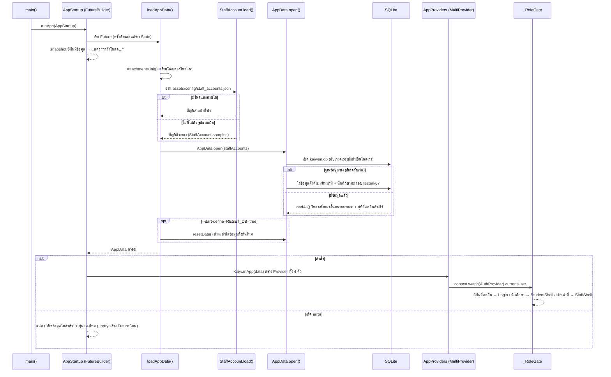

# 2. ลำดับการทำงานตอนเปิดแอป (Startup)

`main()` ไม่รอโหลดข้อมูลก่อน แต่ให้ `AppStartup` รอด้วย **FutureBuilder** (บทที่ 12)
ระหว่างรอแสดง "กำลังโหลด..." ถ้าผิดพลาดแสดงข้อความ + ปุ่มลองใหม่

ไฟล์ที่เกี่ยวข้อง: `lib/main.dart`, `lib/data/staff_account.dart`, `lib/data/app_data.dart`,
`lib/data/app_database.dart`, `lib/providers/app_providers.dart`
