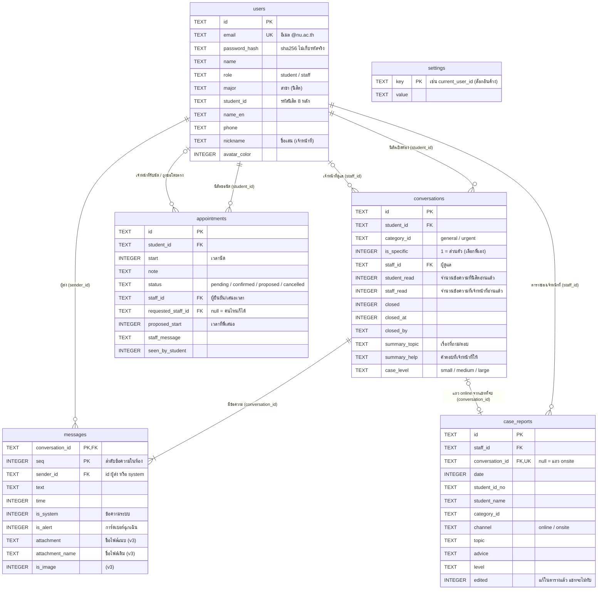

# 3. ER Diagram (ฐานข้อมูล SQLite)

ไฟล์: `lib/data/app_database.dart` · ฐานข้อมูลเวอร์ชัน 3
(v2 เพิ่มตาราง `case_reports`, v3 เพิ่มคอลัมน์ไฟล์แนบใน `messages` — อัปเกรดใน `onUpgrade` โดยข้อมูลเดิมไม่หาย)

หมายเหตุ
- ความสัมพันธ์ (FK) เป็นความสัมพันธ์เชิงข้อมูลที่แอปใช้ ไม่ได้บังคับด้วย FOREIGN KEY ใน SQLite
- `case_reports` เป็นสำเนาแยกจากแชท: แก้ในตารางแล้วไม่กระทบแชท (คอลัมน์ `edited`)
- ตาราง `users` ยังมีคอลัมน์ `specialty` ที่เลิกใช้แล้ว (คงไว้ให้เข้ากับฐานข้อมูลเดิม) จึงไม่แสดงในแผนภาพ
- ภาควิชาไม่ได้เก็บแยก หาจากสาขาด้วย `AppData.departmentOf(major)`
