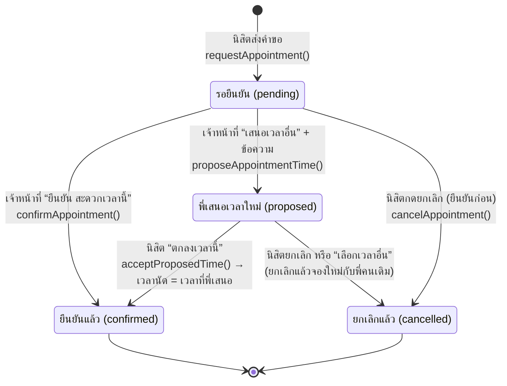
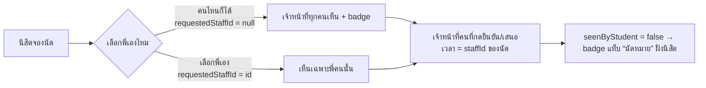

# 5. State Diagram สถานะนัดหมาย

ไฟล์หลัก: `lib/providers/appointment_provider.dart`, `lib/screens/appointment/`
สถานะอยู่ใน `enum AppointmentStatus` (`lib/data/models.dart`)

## ใครเห็นคำขอนัด

กติกาเวลานัด (`AppData`): จันทร์–ศุกร์ 08:30–16:30 ช่วงละ 30 นาที (`isOfficeDay`, `slotsOf`)
เลือกได้ทุกช่องที่ยังไม่ผ่านไป (`isBookable`) เจ้าหน้าที่ตรวจเวลาว่างเอง
ถ้ามีนัดที่ยืนยันแล้วเวลาเดียวกัน การ์ดฝั่งเจ้าหน้าที่จะเตือน (`conflictsOf`)
