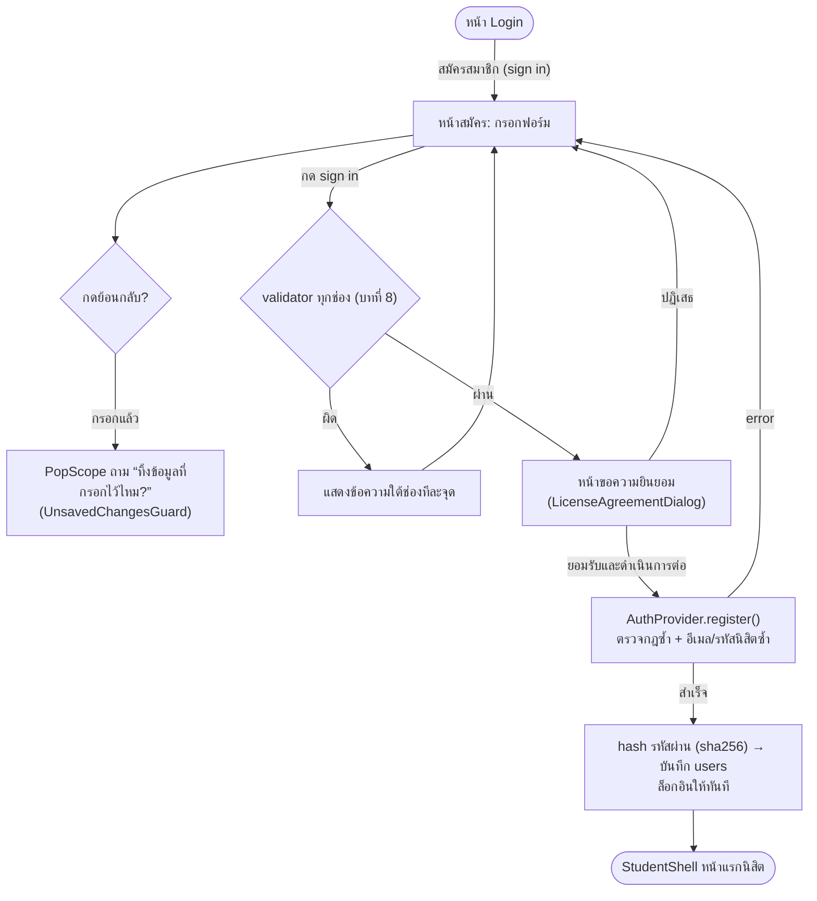
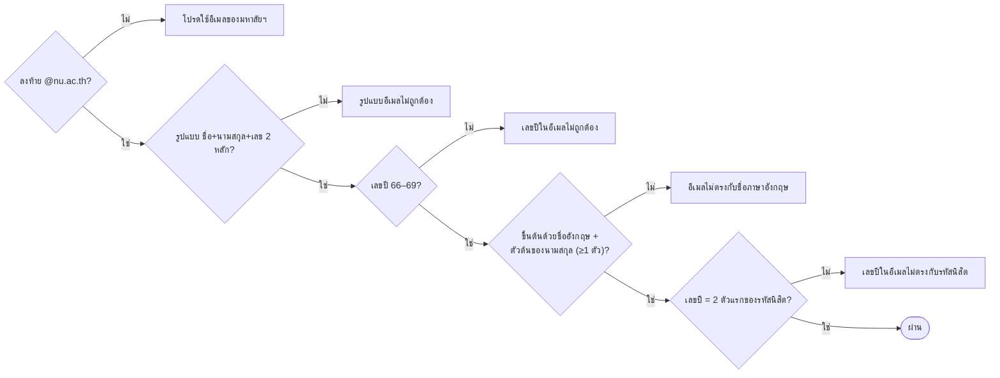
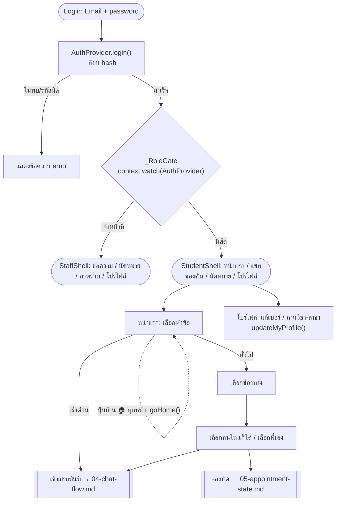

# 6. Flowchart สมัคร/ล็อกอิน + หน้าแรกนิสิต

ไฟล์หลัก: `lib/screens/auth_screens.dart`, `lib/data/registration_rules.dart`, `lib/providers/auth_provider.dart`,
`lib/screens/student_screens.dart`, `lib/screens/profile_screen.dart`

## สมัครสมาชิก

### ลำดับการตรวจอีเมล (`RegistrationRules.emailError`) — บอกจุดผิดทีละจุด

รหัสนิสิต (`studentIdError`): 8 หลัก · 2 ตัวแรก 66–69 · ตัวที่ 3–4 = `31` (คณะวิทยาศาสตร์)

## ล็อกอิน และหน้าแรกนิสิต

