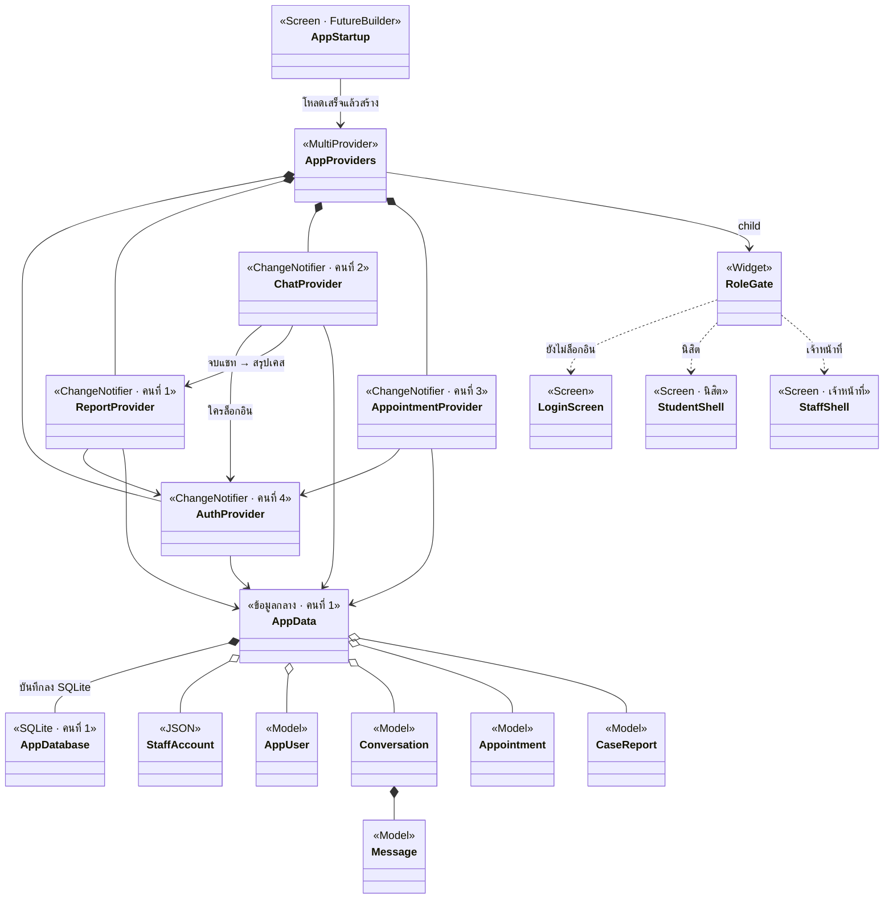
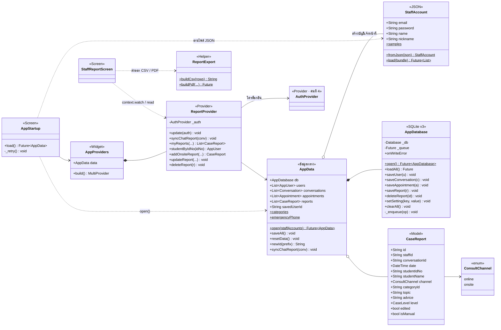
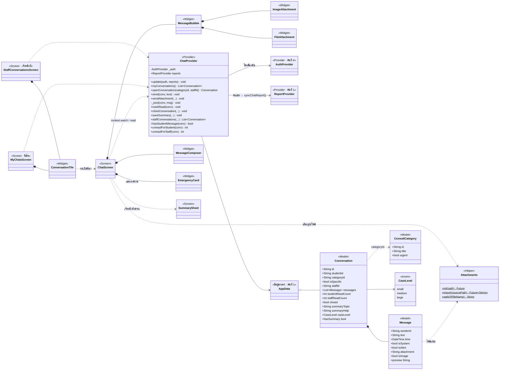
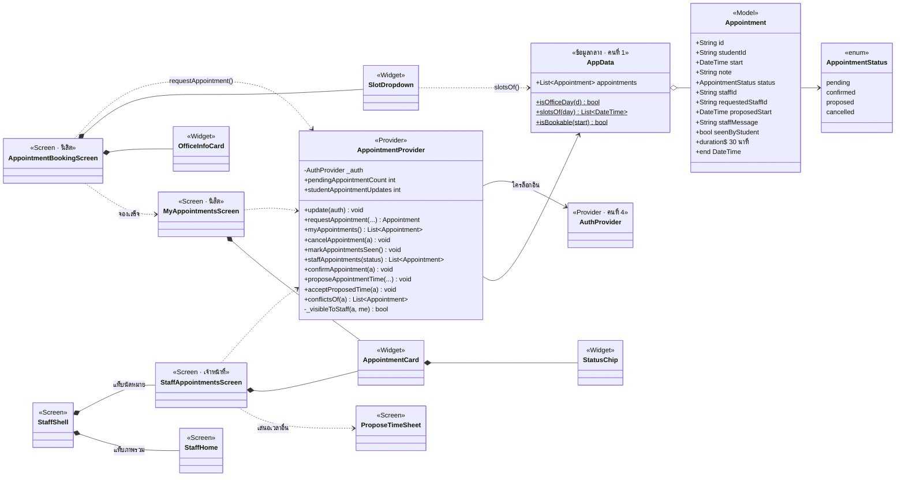
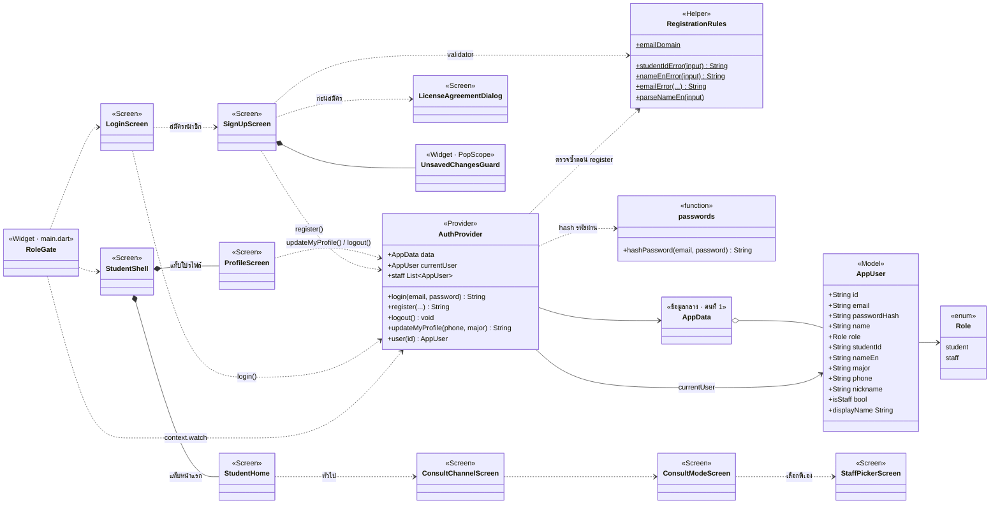

# 7. Class Diagram (UML)

แสดงว่า class ไหนใช้ / ถือ / สืบทอด class ไหน (คล้าย ER Diagram แต่เป็นของโค้ด ไม่ใช่ตาราง)

วิธีอ่านลูกศร

| เส้น | ความหมาย | ตัวอย่าง |
|---|---|---|
| หัวสามเหลี่ยมโปร่ง | ฝั่งไม่มีหัว **สืบทอด** จากฝั่งที่มีหัว (`extends`) | `AuthProvider` → `ChangeNotifier` |
| ข้าวหลามตัดทึบ | ฝั่งข้าวหลามตัด **ถือ** อีกฝั่งไว้ข้างใน เป็นส่วนหนึ่งของมัน | `Conversation` ◆ `Message` |
| ข้าวหลามตัดโปร่ง | ฝั่งข้าวหลามตัด **เก็บรายการ** อีกฝั่งไว้ แต่อีกฝั่งอยู่แยกได้ | `AppData` ◇ `AppUser` |
| ลูกศรเส้นทึบ | ฝั่งต้นเส้น **มีตัวแปร** ชี้ไปฝั่งหัวลูกศร | `ChatProvider` มี `_auth` ชี้ไป `AuthProvider` |
| ลูกศรเส้นประ | ฝั่งต้นเส้น **เรียกใช้** ฝั่งหัวลูกศรชั่วคราว | หน้าจอเรียก `context.read<ChatProvider>()` |

ป้าย `<<Provider>>` `<<Model>>` `<<Screen>>` `<<enum>>` บอกชนิดของ class
`+` = public, `-` = private (ชื่อขึ้นต้นด้วย `_`), `$` = static

## ภาพรวมทั้งแอป

สรุปเป็นชั้น ๆ: **หน้าจอ** → อ่าน/สั่ง **Provider** → Provider แก้ **AppData** (ข้อมูลใน memory) → AppData สั่ง **AppDatabase** บันทึกลง SQLite
Provider ทั้ง 4 ตัว `extends ChangeNotifier` (ป้ายบนกล่อง) เมื่อข้อมูลเปลี่ยนจะเรียก `notifyListeners()` หน้าจอที่ `context.watch` อยู่จึงวาดใหม่
หน้าจอทุกหน้าใต้ `StudentShell` / `StaffShell` เรียก Provider ด้วย `context.watch` / `context.read` (ไม่ได้วาดเส้นไว้ในภาพนี้ เพื่อไม่ให้ภาพรก ดูได้ในภาพแยกของแต่ละคน)

---

## คนที่ 1 · โครงสร้าง + ฐานข้อมูล + ตารางสรุปเคส

## คนที่ 2 · แชท (เร่งด่วน + ทั่วไป)

## คนที่ 3 · นัดหมาย + หน้าหลักเจ้าหน้าที่

## คนที่ 4 · สมัคร · ล็อกอิน · โปรไฟล์ · หน้าแรกนิสิต

หมายเหตุ: `RoleGate` ในโค้ดชื่อ `_RoleGate` (private ใน `main.dart`) และ `passwords` เป็นไฟล์ `passwords.dart` ที่มีฟังก์ชัน `hashPassword()` ไม่ใช่ class
แต่ละภาพแสดง class ของคนอื่นแค่ชื่อพร้อมป้าย “คนที่ x” เพื่อให้เห็นว่าส่วนของตัวเองต่อกับส่วนไหน
